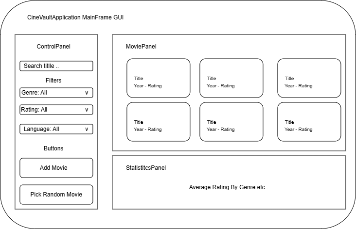

# CineVault GUI Wireframe GUI View

Our Application GUI will be single screen to keep it less complicated and to return all the users requested input on one screen.
- No page navigation.All interactions by the user update this single view.

Single-screen layout inside MainFrame Will Look Like This:

- **Left sidebar (ControlPanel):** search bar, genre/rating/language filter dropdowns, "Add movie" button, "Random pick" button
- **Main area (MoviePanel):** grid of movie cards showing title, year, and rating
- **Bottom strip (StatisticsPanel):** bar chart showing average rating by genre

## Visual OF CineVault GUI
#####  Source/Refrences
Created using [draw.io](https://app.diagrams.net/). Link to Editable Diagram: [CineVaultApplication - MainFrame GUI.drawio](https://drive.google.com/file/d/1LlVWBl9brnzGl4a1f8S5kGxPSrEE5lOa/view?usp=sharing)

