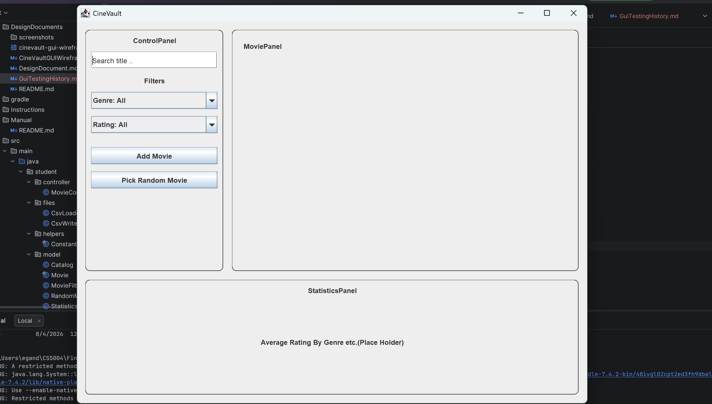
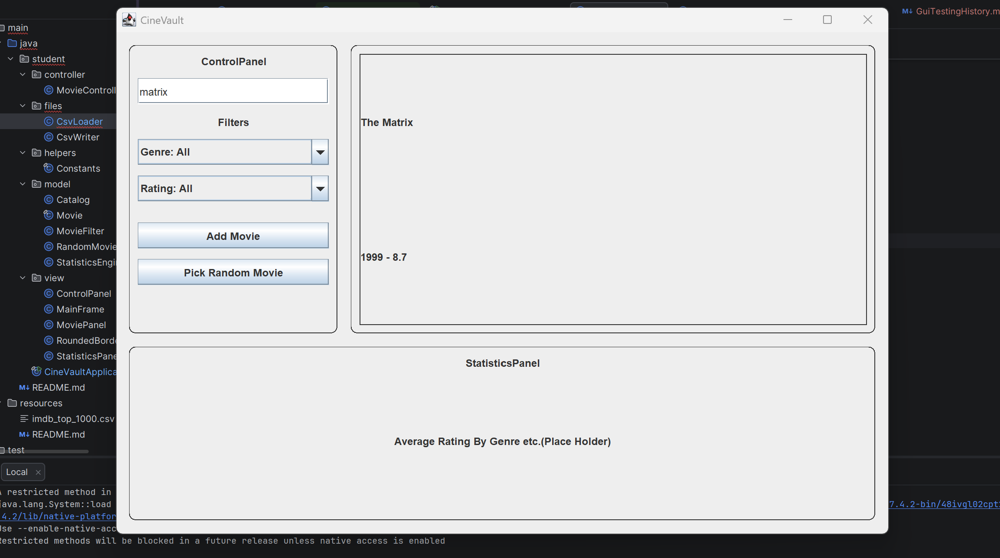

# Testing History

When it comes to testing GUIs you often have to document how you tested, and what you did. Use this document to document, including screenshots of your testing.

## Test 1: Running the application loads the initial GUI window
Ran `./gradlew.bat run`. The CineVault window opened correctly, showing the
ControlPanel on the left with the search field, genre and rating filter dropdowns as well as
Add Movie and Pick Random Movie buttons. It also showed an empty MoviePanel in the center, and
the StatisticsPanel placeholder text at the bottom. No errors appeared in the
console.

## Test 2: Searching for a movie by partial title
Typed "matrix" into the search field and pressed Enter. The MoviePanel
correctly showed a card for "The Matrix" with its year and rating.

